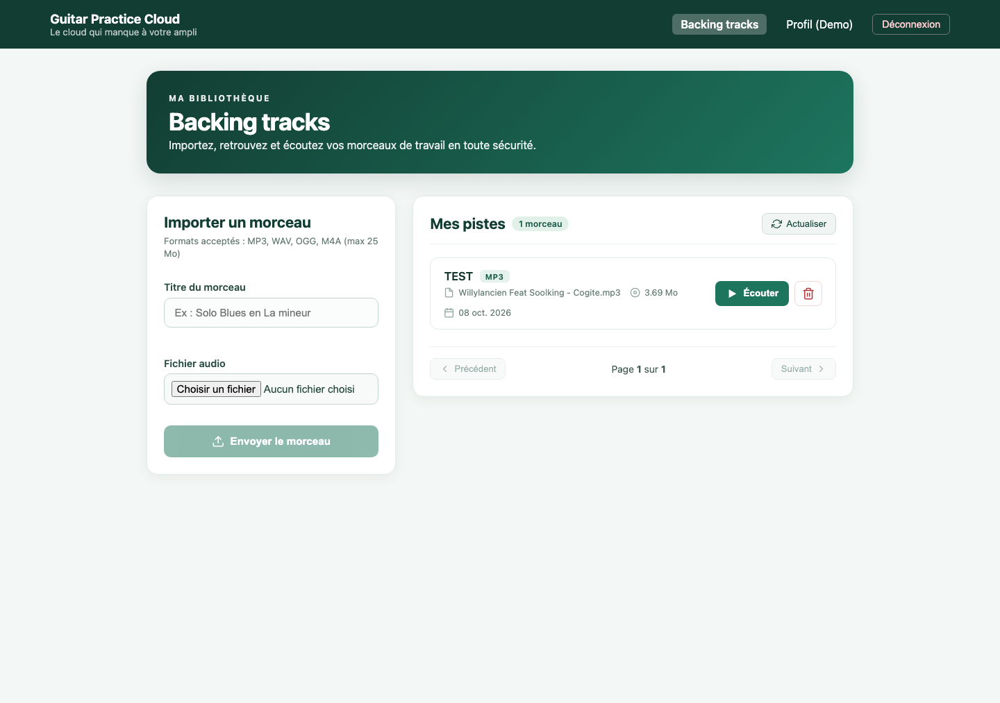

# Guitar Practice Cloud

Application full-stack de gestion et d'écoute de pistes audio, réalisée dans le
cadre des TP du module Angular M1 MIAGE 2026-2027.

**Auteur :** Logan CHARRIER  
**Dépôt GitHub :** <https://github.com/logancharrier/AngularM1_Miage_2026_2027_TP123>



## Dépôt et accès

Le dépôt est public :

<https://github.com/logancharrier/AngularM1_Miage_2026_2027_TP123>

## Présentation

Le projet couvre les trois TP du module :

- **TP1 — Authentification et profil** : inscription, connexion, JWT,
  intercepteur HTTP, guard de route, lecture et modification du profil.
- **TP2 — Bibliothèque audio** : pagination côté serveur, upload multipart avec
  progression, validation des fichiers, lecture audio authentifiée via `Blob`
  et `ObjectURL`.
- **TP3 — Fiabilisation** : suppression des pistes, gestion des erreurs,
  tests automatisés frontend et backend.

L'interface est construite avec les composants standalone d'Angular et les
Signals. Les notifications utilisent `MatSnackBar` d'Angular Material.

## État du projet

| Vérification | Résultat |
|---|---|
| Build Angular | OK |
| Tests frontend | 11 tests / 11 réussis |
| Tests backend | 6 tests / 6 réussis |
| Preuves Network | 11 captures + journaux détaillés |

## Stack technique

| Couche | Technologies |
|---|---|
| Frontend | Angular 22, TypeScript, Signals, Angular Material, Vitest |
| Backend | Node.js, Express 5, Mongoose, MongoDB Atlas, Multer, JWT |
| Outils | npm, Angular CLI, proxy de développement Angular |

## Structure du dépôt

```text
.
├── backend/                       API Express et accès MongoDB
│   ├── src/                       Serveur, routes, modèles et logique métier
│   ├── test/                      Tests backend
│   └── .env.example               Modèle de configuration locale
├── frontend-starter/              Application Angular
│   ├── src/app/components/        Pages et composants
│   ├── src/app/shared/            Services, modèles, guards, intercepteurs
│   └── proxy.conf.json            Redirection /api vers le backend
├── preuves/                       Captures d'écran et journaux Network
├── RAPPORT_IA_MODELE.md           Rapport d'usage de l'IA
├── PREUVES_NETWORK.md             Synthèse des preuves Network
├── SCHEMA_FLUX_CONNEXION.md       Schéma du flux d'authentification
├── API_CONTRACT.md                Contrat des routes HTTP
└── SUJET_ETUDIANT_TP1.md          Sujets des trois TP
```

## Prérequis

- Node.js 22.12 ou plus récent ;
- npm ;
- un accès MongoDB Atlas ;
- Git et un navigateur récent.

La création de la base Atlas est décrite dans
[ATLAS_SETUP.md](ATLAS_SETUP.md).

## Installation et lancement

### 1. Backend

```bash
cd backend
cp .env.example .env
```

Renseigner ensuite dans `backend/.env` :

```dotenv
MONGODB_URI=<uri-mongodb-atlas>
JWT_SECRET=<secret-local-long-et-aleatoire>
PORT=3000
```

Installer les dépendances et démarrer l'API :

```bash
npm install
npm start
```

L'API écoute sur `http://localhost:3000`.

### 2. Frontend

Dans un second terminal :

```bash
cd frontend-starter
npm install
npm start
```

Ouvrir ensuite `http://localhost:4200`.

Le fichier `proxy.conf.json` redirige les requêtes `/api` vers le backend local
sur le port `3000`.

### Compte de démonstration

```text
Email : demo@example.com
Mot de passe : Demo1234!
```

## Tests et build

### Frontend

```bash
cd frontend-starter
npm test
npm run build
```

- `npm test` exécute les tests Vitest (services, intercepteur, guard).
- `npm run build` produit le bundle Angular dans `frontend-starter/dist/`.

### Backend

```bash
cd backend
npm test
```

Les tests backend vérifient notamment le schéma, la santé de l'API, le refus des
requêtes sans JWT ou avec un JWT invalide, ainsi que les erreurs d'upload.

Les tests backend ne nécessitent pas de connexion MongoDB.

## Documentation et preuves

- [RAPPORT_IA_MODELE.md](RAPPORT_IA_MODELE.md) : outils et modèles utilisés,
  prompts, plans, vérifications et résultats par mission.
- [PREUVES_NETWORK.md](PREUVES_NETWORK.md) : captures d'écran et preuves des
  requêtes HTTP.
- [preuves/journal-requetes.md](preuves/journal-requetes.md) : journal des
  requêtes d'authentification, d'upload, de lecture et de suppression.
- [preuves/journal-pagination.md](preuves/journal-pagination.md) : journal de la
  pagination page 1 / page 2.
- [SCHEMA_FLUX_CONNEXION.md](SCHEMA_FLUX_CONNEXION.md) : schéma annoté du flux de
  connexion.
- [API_CONTRACT.md](API_CONTRACT.md) : contrat des routes et formats échangés.
- [SUJET_ETUDIANT_TP1.md](SUJET_ETUDIANT_TP1.md),
  [SUJET_ETUDIANT_TP2.md](SUJET_ETUDIANT_TP2.md) et
  [SUJET_ETUDIANT_TP3.md](SUJET_ETUDIANT_TP3.md) : sujets des trois séances.
- [CONSEILS_POUR_UTIISER_ASSISTANT_AI.md](CONSEILS_POUR_UTIISER_ASSISTANT_AI.md) :
  conseils d'utilisation des assistants IA.

Les fichiers audio de test sont disponibles dans
`frontend-starter/fichiers-audio-de-test/`.

## Sécurité

- Ne jamais versionner `backend/.env` ni y copier un URI MongoDB ou un secret
  JWT.
- Les jetons JWT et les mots de passe ne doivent pas apparaître dans les
  captures d'écran, les journaux ou les prompts.
- Les fichiers uploadés et les dossiers `node_modules` ne sont pas inclus dans
  le dépôt.
- Les preuves Network fournies masquent volontairement la valeur du header
  `Authorization`.

## Usage de l'IA

Le détail des outils, modèles, prompts et vérifications humaines est documenté
dans [RAPPORT_IA_MODELE.md](RAPPORT_IA_MODELE.md).
