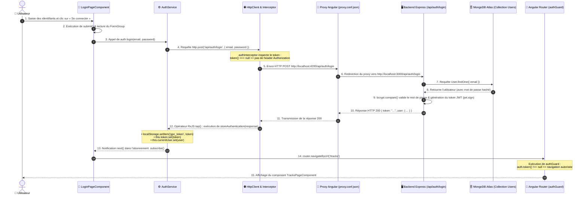

# Schéma annoté du flux de connexion — TP1

Ce document décrit le trajet complet d’une requête d’authentification lors d’un clic sur **« Se connecter »** dans l’application Angular, jusqu’à la redirection vers la page protégée.

---

## 1. Schéma séquentiel du flux (Mermaid)

---

## 2. Explication étape par étape

| Étape | Acteur / Fichier | Description détaillée |
|---|---|---|
| **1 & 2** | [`LoginPageComponent`](file:///Users/logancharrier/Documents/M1/Web/AngularM1_Miage_2026_2027_TP123/frontend-starter/src/app/components/login-page/login-page.ts) | L'utilisateur soumet le formulaire. La méthode `submit()` extrait les valeurs `email` et `password` via `this.form.getRawValue()`. |
| **3 & 4** | [`AuthService`](file:///Users/logancharrier/Documents/M1/Web/AngularM1_Miage_2026_2027_TP123/frontend-starter/src/app/shared/services/auth.service.ts) | Le composant appelle `this.auth.login(email, password)`. Le service utilise `HttpClient.post<AuthResponse>('/api/auth/login', ...)`. |
| **5 & 6** | [`proxy.conf.json`](file:///Users/logancharrier/Documents/M1/Web/AngularM1_Miage_2026_2027_TP123/frontend-starter/proxy.conf.json) | La requête est émise sur `http://localhost:4200/api/auth/login`. Le serveur de dev Angular la transfère au backend Express sur `http://localhost:3000/api/auth/login`. |
| **7 & 8** | Backend & MongoDB | Le backend Express recherche l'utilisateur par email dans MongoDB Atlas via Mongoose. |
| **9 & 10** | Backend Express | Le mot de passe est vérifié avec `bcrypt.compare`. S'il est valide, un JWT est signé avec la clé secrète et renvoyé dans une réponse `200 OK` avec les données de l'utilisateur. |
| **11 & 12** | [`AuthService`](file:///Users/logancharrier/Documents/M1/Web/AngularM1_Miage_2026_2027_TP123/frontend-starter/src/app/shared/services/auth.service.ts) | L'opérateur RxJS `tap()` déclenche `storeAuthentication()` : le token est persisté dans le `localStorage` pour les sessions futures, et les signaux réactifs `token` et `currentUser` sont mis à jour (`set()`). |
| **13 & 14** | [`LoginPageComponent`](file:///Users/logancharrier/Documents/M1/Web/AngularM1_Miage_2026_2027_TP123/frontend-starter/src/app/components/login-page/login-page.ts) | Le bloc `next` de la souscription reçoit la réponse positive et déclenche la redirection vers `/tracks` via `router.navigateByUrl('/tracks')`. |
| **15** | [`authGuard`](file:///Users/logancharrier/Documents/M1/Web/AngularM1_Miage_2026_2027_TP123/frontend-starter/src/app/shared/guards/auth.guard.ts) | Le guard vérifie que `auth.token()` est non-null. La route s'active et [`TracksPageComponent`](file:///Users/logancharrier/Documents/M1/Web/AngularM1_Miage_2026_2027_TP123/frontend-starter/src/app/components/tracks-page/tracks-page.ts) est affiché à l'utilisateur. |

---

## 3. Distinction des routes : Publiques vs Protégées

Conformément à [`API_CONTRACT.md`](file:///Users/logancharrier/Documents/M1/Web/AngularM1_Miage_2026_2027_TP123/API_CONTRACT.md) :

* **Routes publiques (aucun header `Authorization` requis) :**
  * `GET /api/health` — Contrôle d'état.
  * `POST /api/auth/register` — Inscription d'un nouvel utilisateur.
  * `POST /api/auth/login` — Authentification de l'utilisateur.

* **Routes protégées (header `Authorization: Bearer <token>` obligatoire, ajouté par [`authInterceptor`](file:///Users/logancharrier/Documents/M1/Web/AngularM1_Miage_2026_2027_TP123/frontend-starter/src/app/shared/interceptors/auth.interceptor.ts)) :**
  * `GET /api/users/me` — Récupération du profil connecté.
  * `PUT /api/users/me` — Modification des informations utilisateur.
  * `GET /api/tracks` — Lecture de la bibliothèque audio.
  * `POST /api/tracks` — Téléversement de pistes audio (multipart).
  * `GET /api/tracks/:id/audio` — Écoute du flux audio.
  * `DELETE /api/tracks/:id` — Suppression d'une piste.

---

## 4. Signal vs `localStorage`

* **Signal Angular (`signal()`) :**
  * **Nature :** État réactif en mémoire vive (RAM) de l'application JavaScript.
  * **Rôle :** Met à jour automatiquement et de façon chirurgicale les composants et templates qui en dépendent dès que sa valeur change (`set()` ou `update()`).
  * **Cycle de vie :** Volatile ; perdu au rechargement de la page (F5).
* **`localStorage` :**
  * **Nature :** Système de stockage clé-valeur persistant fourni par le navigateur web (disque client).
  * **Rôle :** Conserver des données simples (comme la chaîne du token JWT) entre les fermetures d'onglets et les rafraîchissements de page.
  * **Cycle de vie :** Persistant jusqu'à suppression explicite ou nettoyage du cache.
* **Complémentarité dans l'application :** `AuthService` utilise `localStorage` pour la **persistance**, et initialise son Signal `token` avec la valeur lue au démarrage pour assurer la **réactivité** de l'interface et du guard.
